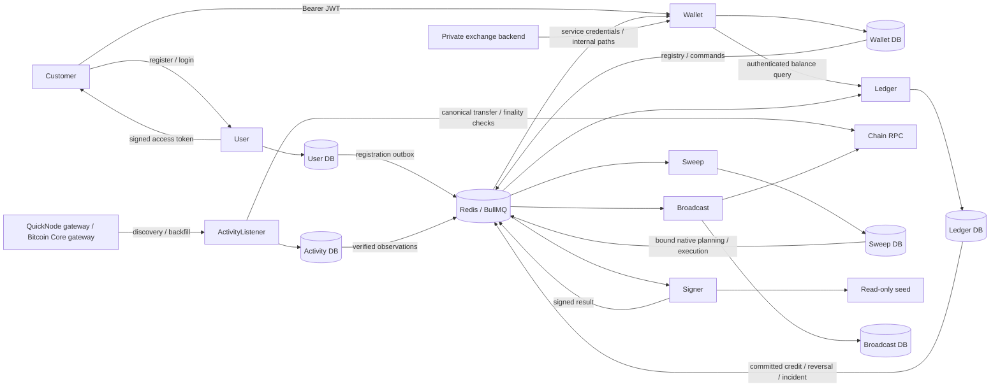

# Exchange infrastructure architecture

Updated: 11 October 2026. This deployment serves one exchange owner. Customer identity, custody balances, and customer liabilities are separate concerns.

## Services and database ownership

| Application      | Owns                                                                                                                                                                                                                                                                                      | Communication                                                                                        |
| ---------------- | ----------------------------------------------------------------------------------------------------------------------------------------------------------------------------------------------------------------------------------------------------------------------------------------- | ---------------------------------------------------------------------------------------------------- |
| User             | Identity, email/password registration/login, password hashes, access-token issuance                                                                                                                                                                                                       | Public registration/login HTTP; secret-free `user.registered.v1` to Wallet                           |
| Wallet           | User/customer mapping, custody domain/network/asset policy, hot/management bootstrap, account allocation, registry, deposit-address readiness/history, customer APIs, authoritative execution/resource fences and native sweep/withdrawal settlement and customer withdrawal coordination | Public JWT-authenticated HTTP; registry/action queues to workers; authenticated Ledger balance reads |
| ActivityListener | Provider watch/backfill registry, RPC verification, transfer identity/finality, deposit observations and custody exceptions                                                                                                                                                               | QuickNode gateway and Pub/Sub; verified deposit/incident events to Ledger; history to Wallet         |
| Ledger           | Customer pending/available/reserved/frozen liabilities, custody accounts, immutable balanced journals, holds, compensation, accounting results                                                                                                                                            | Deposit results and custody incidents independently delivered to Wallet and Sweep                    |
| Sweep            | Customer/hot registry projection, credited-deposit eligibility, coalesced source/asset work, immutable native sweep operations/attempts, scheduling, recovery and review gates                                                                                                            | Consumes committed Ledger events and registry commands; queued Wallet planning/execution requests    |
| Signer           | Seed access, key derivation, independent spending-policy authorization, ephemeral private keys, signing/result attestation                                                                                                                                                                | Authenticated queue commands/results; no database                                                    |
| Broadcast        | Immutable signed bytes, submission, retries, confirmation/expiry/reconciliation                                                                                                                                                                                                           | RPC and authenticated queues; operation status to its coordinator                                    |

Every database-owning service has its own Prisma schema, generated client, migration history, database credentials, inbox/outbox where needed, and lifecycle hooks. No application imports another application's implementation or queries its database. Database ownership is enforced in application import lint rules. Redis/BullMQ carries durable action queues with competing workers; it is not Redis Pub/Sub transport. Provider discovery enters through Google Cloud Pub/Sub.

## Registration and the single owner

`POST /v1/users/register` on User accepts only email and password. It normalizes email by trimming and lowercasing, enforces unique email, and stores an async scrypt hash with a random salt. Passwords retain their exact Unicode bytes, with 15–128 Unicode code points and no trimming/truncation. Responses expose only `userId`, normalized email, and creation time; queue events contain only `userId`, never email, password, or hash. User has no wallet, balance, deposit, or blockchain API.

The user row and `user.registered.v1` delivery commit together. Wallet consumes the authenticated event with durable receipt/content checks and creates `customerId = userId`, `externalId = userId`. Wallet's customer projection, inbox receipt, and Ledger registration command commit in one transaction. Ledger acknowledges identity before balances or addresses become ready. Lost queue acknowledgments and replay cannot change identity or clear a freeze. Wallet's former backend `POST /v1/customers` registration route is removed; registration originates in User. The internal non-UUID fixture/import helper does not claim User UUID identities.

`POST /v1/users/login` verifies email/password and returns an RS256 access token with a User UUID subject, issuer, audience, issue/expiry times, unique token ID, and reset epoch. The default lifetime is 15 minutes. User holds the private token key; Wallet holds only its public verification key and verifies tokens locally without querying User's database or HTTP API. Public Wallet `/v1/me` routes derive ownership from the verified subject and reject caller-supplied customer identities. Registration provisioning is asynchronous: `GET /v1/me` returns HTTP 202 while Wallet awaits the identity event. See [authentication setup and API contract](user-authentication.md).

There is no tenant field, request tenant context, key map, or tenant-scoped identity. Legacy operations moved to `/internal/wallets` and `/internal/transactions` with `WALLET_API_KEY`; administrative customer routes moved to `/internal/customers` with `EXCHANGE_API_KEY`. Ledger's `/internal` read API requires `LEDGER_API_KEY` and a private network. These service credentials remain distinct from `QUEUE_AUTH_KEY`; customer access tokens cannot authorize operational routes, and service keys cannot authorize `/v1/me`. A technical `EXCHANGE_DOMAIN_ID` binds custody seed/network configuration, operation ownership, and reset safety; it represents custody configuration rather than another owner.

User has an 8 KiB request limit, independent registration/login IP/global throttles, and one bounded hashing pool for both operations. Login uses the same scrypt work for missing accounts and incorrect passwords, returns a generic 401, and sets token responses to `no-store`. Socket peer addresses are used without trusting caller-supplied forwarding headers. Default hashing concurrency is two; overload returns HTTP 429. The scrypt parameters follow the [OWASP password storage guidance](https://cheatsheetseries.owasp.org/cheatsheets/Password_Storage_Cheat_Sheet.html#scrypt). Shared edge/distributed limits are required before scaling public authentication across replicas. Refresh tokens, session revocation/logout, email verification, MFA, and password reset remain later identity work.

Only User and Wallet publish application HTTP ports in [the development application overlay](../compose.apps.yaml). Signer, Broadcast, ActivityListener, and Sweep run Nest application contexts without HTTP listeners; Ledger provides authenticated private reads plus operator event/reconciliation compatibility routes. Normal inter-service actions, registration, registry updates, and financial state changes use authenticated BullMQ queues with transactional outboxes; Ledger's operator compatibility actions remain private and service authenticated. Wallet-to-Ledger HTTP remains a read-only exception and no longer registers wallets during balance reads. Public ingress must route User's `/v1/users/*`, Wallet's `/v1/me/*`, and optional public Wallet documentation only; deny Wallet `/internal/*` at the edge and keep Ledger off public ingress.

## Custody and address issuance

Wallet's `CustodyDomain`, `CustodyNetwork`, `ManagementWalletPurpose`, and `AssetConfiguration` are the custody authority. The initial generation pins one seed, reset epoch, policy/configuration revision, and one network per chain: Sepolia, Bitcoin regtest, and Solana Devnet. Native metadata and management caps match [the initial decisions](exchange-wallet-initial-decisions.md). Roles, customer/hot ownership, and composite domain/epoch/seed/network constraints are enforced in PostgreSQL. Bootstrap idempotently creates hot0 for all three chains and management1 for Ethereum/Solana. Accounts 2–9 require approved purpose policy; Bitcoin management1 remains unallocated.

Customer accounts use one noncycling PostgreSQL sequence across chains, beginning at 10 and ending at `2147483647`. Concurrent/repeated issuance cannot claim reserved accounts or allocate a second active customer/network identity. Transaction rollback can leave gaps. Customer assignment and its issuance command commit together; missing bootstrap retains blocked assignment work, which resumes when bootstrap completes.

The following private Wallet endpoints require `WALLET_API_KEY`. Mutations return HTTP 202 after committing a command to the Wallet outbox; workers perform bootstrap or management creation. They do not bypass queue processing.

| Endpoint                                                                       | Action                                                                                          |
| ------------------------------------------------------------------------------ | ----------------------------------------------------------------------------------------------- |
| `POST /internal/custody/bootstrap` with `{}`                                   | Queue idempotent hot0/management1 bootstrap.                                                    |
| `POST /internal/custody/management-wallets` with `chain`, `network`, `account` | Queue a management account 1–9 request; default 1. The worker requires approved purpose policy. |
| `GET /internal/custody`                                                        | Read configured generation and hot/management derivation/publication status.                    |

Wallet allocation commits an immutable derivation request and Signer outbox entry together. Signer checks the configured domain, seed, network, role, account, canonical path, and request digest before deriving an address. Wallet validates the returned binding against its authoritative row before atomically marking it ready and publishing one registry event to Ledger, ActivityListener, and Sweep. Delayed, altered, or stale results cannot change ownership or expose an address.

`POST /v1/me/deposit-addresses` supports the configured Ethereum/Bitcoin/Solana networks. Its assignment response exposes an address only when the current authoritative wallet, registry projection, Ledger customer registration, matching hot0 and required management1, and customer Ledger/listener acknowledgments and backfill cursor are ready. Paused domains, disabled configuration, stale revisions, and mismatched ownership leave the assignment waiting. Registry acknowledgments cannot create a custody wallet absent from Wallet's authority.

Bitcoin regtest uses `m/84'/1'/{account}'/0/0`, `bcrt` addresses, network-correct signing, and RPC identity checks. Configure `CHAIN_NETWORKS={"bitcoin":{"network":"regtest","rpcNetwork":"regtest"}}` consistently: the generic default remains mainnet, and custody bootstrap rejects it. Fixture tests cover these primitives; live node/provider acceptance remains pending. Native observation/credit flags support development tests, while sweep/withdrawal flags remain disabled. Independent native-sweep signing authorization is implemented. Management funding budgets/execution remain Phase 6; hot-wallet withdrawals remain Phase 5.

## Deposits and Sweep boundary

ActivityListener installs watches only for customer deposit addresses in the native rollout. It retains hot/management registry projections for classification, without installing customer-style watches on those accounts. Provider notifications supply lookup hints; RPC verification determines canonical transfers, base units, and finality. Initial historical backfill and watch acknowledgment are prerequisites for exposing an address. QuickNode is selected for Ethereum/Solana; its external gateway deployment/certification remains a rollout gate.

ActivityListener does not schedule sweeps or sign/broadcast. It observes both directions at customer addresses: outflows must remain visible to detect unauthorized movement, attribute failed fees, and compensate reorgs. Registered funding, sweep receipts, refunds, and change never mint a customer credit. Unexpected or incomplete customer spends produce incidents/review gates. This auditing is part of verified observation, not execution orchestration.

Ledger credits a finalized eligible deposit once and emits `deposit.credited.v1` from the same transaction as the journal. Separate outbox records deliver the identical accounting result to Wallet and Sweep, each with independent retries/inbox retention. Pending deposit discovery does not schedule a sweep. Reversals, deficits, and custody incidents also reach Sweep so delayed/reordered events cannot bypass review.

ActivityListener retains finalized inclusion evidence separately from a replacement pending observation. A proven orphan compensates prior credit/loss before replacement finality; RPC uncertainty preserves the prior evidence and credit. Registry recovery filters eligible networks before applying batch limits, so disabled rows cannot starve certified networks. Ledger persists reversal-first settlement fences independently of an operation: stale settlement cannot consume a withdrawal hold, release remains blocked under uncertainty, and compensation is posted only when an original journal exists. Settlement fee-cap, custody-shortfall, and reorg incidents fan out atomically to Wallet and Sweep.

Sweep owns its registry projection, durable coalesced source/asset work, operations, attempts, generation consumption, retry lineage and exceptions. It treats credited amounts as hints and requests canonical preparation from Wallet. Wallet reserves the source and nonce/outpoints before preparation, revalidates resources and current authority, and publishes an independently authorized Signer command after Sweep accepts the exact prepared amount. Both schedulers remain disabled by default. Missing readiness, review gates, dust, fee changes and unsupported assets defer work without treating journal balances as spendable resources.

Signer verifies a Wallet Ed25519 authorization independently of queue HMAC, then attests the whole result using another Ed25519 pair. For sweeps, source paths/accounts belong to customer deposit wallets >=10 and the destination derives as the same custody seed's hot0. For withdrawals, the source derives as hot0 and authorization binds the external recipient, principal and original Ledger hold. Wallet verifies and persists the attestation/signed bytes before queuing Broadcast. Broadcast independently verifies that attestation and retains same-byte retries. Custody deployments block unbound legacy signing/broadcast even when native execution is disabled.

Wallet independently observes canonical native outcomes and actual fees. Ledger journals custody-only sweep movement/fees and delivers accounting results independently to Wallet and Sweep. Release requires a fresh canonical observation and a matching Ledger revision; Sweep also requires Wallet terminal proof bound to that settlement revision. Listener classifies the persisted attempt/hash and audits outgoing movements; Wallet alone owns native sweep and withdrawal settlement/reversal revisions.

Each native operation has one immutable attempt. Safely unsigned sweep retries have linked new operations; signed or uncertain attempts cannot be replaced automatically. RPC outages retain evidence and resources. Proven reorgs compensate once and pause custody for review; higher canonical re-inclusion can settle the same bytes. Periodic scans repair residual/missed work, and paused signed attempts retain attestations for same-byte dispatch after explicit policy recovery. Management funding is implemented in Phase 6; the complete operator recovery UI remains Phase 7. See [Phase 4 implementation notes](exchange-wallet-phase4.md) for contracts, adapter bounds, key ownership, recovery limits and enablement gates.

## Hot-wallet withdrawals

Wallet's `withdrawals/` module owns immutable customer-scoped intents, accepted zero development fees, queued Ledger holds, hot scheduling, cancellation and status projection. Public `POST/GET /v1/me/withdrawals`, status and cancellation routes derive customer identity solely from User JWTs. The strict API permits only canonical asset, external destination, positive base-unit amount and a body `idempotencyKey`; it rejects customer-selected transaction resources and exchange-owned destinations.

A logical hold can wait for hot liquidity. One active intent reserves hot0 and nonce/outpoints/account resources before preparation; later withdrawals stay queued. Current authority and destination ownership are checked again before authorization and dispatch. Wallet commits Ledger/Activity execution intent with the independent Signer authorization outbox, so safely unsigned cancellation cannot race a previously published execution intent. Cancellation and authorization acquire the same source/withdrawal locks. Once authorization exists, the hold remains under uncertainty.

Native withdrawals preserve the accepted principal; Bitcoin change returns only to hot0 and Solana retains hot rent. Failed on-chain transactions release principal and journal actual exchange-paid fees. Outgoing reorg compensation restores the original obligation, pauses custody and reconciles the same bytes without an automatic second payout. Each logical withdrawal currently has one immutable attempt; automatic replacements/blockhash refresh and batching are deferred. Wallet repair scans recover lost hold/planning/preparation/status/release messages without another obligation. See [Phase 5 implementation notes](exchange-wallet-phase5.md) for API, state, tests, limits and rollout gates.

`ENABLE_NATIVE_WITHDRAWALS` independently gates Wallet, Signer and Broadcast; native asset `withdrawal_enabled` and `ALLOW_BROADCAST` remain additional gates. Both native feature flags default to false and share the existing scoped spending-authority/Signer-attestation keys. Only Wallet and User remain public applications.

## Transfer-only recipient policy and Phase 6 components

The 11 October product decision excludes arbitrary contract calls, approvals and EVM batch-contract adapters. Native ETH and ERC-20 recipients must have no deployed/delegated code at finalized and pending checks; reject reserved/precompile addresses. Recheck recipient code before native broadcast. This is a current-state check, not an atomic guarantee against recipient state changes after the RPC read. Native Solana/SPL wallet recipients must be on-curve and ordinary non-executable, data-free System accounts if present. SPL transfers still invoke the classic Token Program and use the recipient owner's derived associated token account; token accounts are not EOAs.

`ChainModule` exports read-only `TokenPlanner` and `TokenObserver` components. Typed token requests contain only an exact ERC-20 transfer or SPL `TransferChecked` plus optional associated-account creation. Supported-asset transfer certificates pin mint/precision/program or immutable runtime-code hash; they do not grant a general contract-call permission. `TokenSigningPolicy` independently verifies Wallet-signed token authorizations, customer/hot derivations and management1 sponsorship. Its separate private queue command is wired into the Signer processor behind a disabled-by-default token-signing flag; Wallet emits it only after purpose-specific preparation and durable source/payer resource claims. Installed Wallet Core signs both SPL authorizations; an independent decoder checks message permissions/instructions and both signatures.

Phase 6 integrates token custody across the existing private queues. Wallet persists token/source/payer/ATA resource claims and management fee budgets; management1 ERC-20 gas funding uses a separate purpose-bound native authorization. Funding and token intents require both Ledger and Listener acknowledgments before broadcast, and funding must canonically settle before its dependent sweep proceeds. Sweep serializes assets at each customer source, checks token residuals first and asks Wallet to verify canonical token inventory before native drain. Listener owns token-specific watch generations/cursors, maps SPL token accounts to customer owners and credits only certified, historically covered deposits. Ledger attributes sponsor fees and hot recoverable rent to their custody owners, preserves customer liabilities during sweeps/funding and settles withdrawals against their original holds. See [Phase 6 implementation notes](exchange-wallet-phase6.md).

## Nest modules and transport adapters

Each application has a small `main.ts` and root `AppModule`. Feature modules export only providers needed by that application. Controllers/processors validate input and delegate to injectable services. `@nestjs/config` factories validate settings and inject typed configuration; application services do not read `process.env` directly.

- User: `users/`, `users/dto/`, `auth/`, shared password hashing/throttle providers, `prisma/`, and registration outbox relay.
- Wallet: `auth/`, `wallets/`, `transactions/`, `customers/`, `custody/`, `custody-api/`, `exchange-messaging/`, `execution/`, `withdrawals/`, `messaging/`, `ledger/`, and `prisma/`.
- Sweep: `sweep/` processor/application service, registry/deposit/work projections, `prisma/`, and shared outbox infrastructure.
- ActivityListener: `registry/`, `provider/`, `exchange/`, Pub/Sub transport, legacy activity workflow, and `prisma/`.
- Ledger: `accounts/`, `journal/`, `deposits/`, `reservations/`, `settlements/`, `incidents/`, `exchange/`, and `prisma/`.
- Signer and Broadcast retain their `signing/` and `broadcast/` feature boundaries.

Strict Zod schemas are the runtime contract for HTTP and queue payloads. `ZodValidationPipe`, UUID pipes, and `SafeErrorsFilter` provide validated/safe HTTP boundaries. Wallet Swagger documents public customer routes with bearer JWT and excludes internal paths. Customer guards validate signature, fixed algorithm, issuer/audience, bounded lifetime, UUID subject, and reset epoch; service guards protect internal APIs. Workers authenticate HMAC envelopes and reject stale `RESET_EPOCH` before financial transitions. `ActionRejectedError` means a permanent invalid action; missing registry/state dependencies remain retryable and never consume a durable inbox receipt prematurely.

## Durability, lifecycle, and development setup

State changes that schedule actions use the owning Prisma transaction for outbox writes. Independent consumer deliveries share the event identity/payload but have separate delivery records. Consumers retain durable event IDs and content digests after queue retention. Aggregate revision guards and database locks protect transitions. Queue HMAC is transport authentication; native signing/role/destination authorization uses independent Ed25519 spending and result-attestation keys.

Prisma providers connect/disconnect through Nest lifecycle hooks. Worker shutdown drains consumers; outbox relays stop timers and complete an active flush. ActivityListener retains its verification/registry recovery scans. Sweep has a bounded durable scheduling loop; Wallet has a bounded canonical execution repair loop. Both require explicit native enablement. User is a producer-only HTTP service with an outbox relay.

`nest-cli.json` declares seven applications. Build generates all six Prisma clients, builds every app, and compiles tests/tools. `dev:*`, `build:*`, and `start:*` include User and Sweep. Default local database ports are Wallet 5432, Broadcast 5433, Ledger 5434, ActivityListener 5435, Sweep 5436, and User 5437; default HTTP ports are Wallet 3000, User 3001, and Ledger 3010. Compose and CI use separate databases for all six owners. `migrate:user` and `migrate:sweep` apply only those schemas.

Wallet/Ledger tenant removal, custody allocation, and settlement/inclusion fixes use additive migrations; historical SQL remains unchanged. Conflicting global development external identities cause migration failure rather than an implicit merge. `npm run reset:development` defaults to a dry run and requires six explicit distinct loopback databases plus loopback Redis/Pub/Sub endpoints. Applying requires stopped workers/publisher and acknowledged provider-watch removal. A durable epoch/marker and exclusive owner lock fence interrupted resets; `--resume` uses persisted state and rejects foreign queue/subscription namespaces. Only retired project queues/subscriptions are removed. See [the operator reset sequence](exchange-wallet-initial-decisions.md#p0-07--complete-the-asynchronous-state-reset).

`npm run rehearse:reset` uses six test database connections, `TEST_REDIS_URL`, and a loopback Pub/Sub emulator to create and remove fresh isolated resources. The default hook verifies real custody bootstrap, bound Wallet Core derivation, first customer account 10, stable hot0 addresses across two resets, and empty Ledger liabilities. The real rehearsal also verifies interrupted-reset resume, stale queue rejection, stale provider quarantine, and preservation of unrelated resources. PostgreSQL roles need sibling-database creation permission. Supplied test databases, project `.env`, application databases, and deployment seed are untouched; this does not establish external watch retirement or live RPC/provider readiness.

No actual deployment reset or application migration is performed as part of this code change. Existing environments must replace `WALLET_API_KEYS` with one `WALLET_API_KEY`, add all six database URLs/settings, set the explicit regtest profile, and configure separate token keys before starting revised services. `setup:local` generates a distinct RSA token key pair and two independent Ed25519 execution-policy pairs for fresh environments; `setup:execution-policy` provisions missing execution keys without overwriting existing files or enabling sweeps. Production User/Wallet startup requires the appropriate key; development login/customer routes return 503 if absent.

Real PostgreSQL/Redis tests verify financial/outbox/inbox and custody behavior; compiled Nest tests verify controllers, guards, DI metadata, and registration limits. RPC/provider fixtures remain deterministic and no test sends live funds. Implemented bootstrap/reset tooling still needs coordinated application to the actual deployment, live RPC identity checks, external provider certification, and the Phase 4/5 gates in the [exchange checklist](exchange-wallet-todo.md).

### Phase 6 financial and queue integration status

`ENABLE_TOKEN_EXECUTION=false` gates Wallet/Sweep/Broadcast and `ENABLE_TOKEN_SIGNING=false` independently gates private Signer token authorization. Native enablement never authorizes tokens. Service-authenticated `POST /internal/custody/assets` configures immutable transfer certificates and monotonic observation/credit/sweep/withdrawal flags; it adds no public worker endpoint. Missing certified gateway coverage, native capital or asset flags blocks activation. Failed transactions post fees only; canonical reorgs restore the original withdrawal obligation, reverse principal/fees/rent once and retain source claims. Deployment of the separate QuickNode gateway, actual token certification and opening native capital are explicit activation gates, not implicit defaults.

## Operational recovery — Phase 7

Wallet's `operations/` module owns audited private commands, monitoring schedules, funding controls, alerts and metric projections. Ledger's `operations/` module owns immutable custody evidence and per-asset comparisons against custody/rent, customer liabilities, equity, fees, deficits and in-transit accounts. Canonical samples and results use authenticated queues; databases remain application-owned. Monitoring covers published hot/management/customer addresses through RPC while Listener provider subscriptions remain customer-only.

Private `/internal/operations` routes require both Wallet's backend credential and a distinct operations credential. Operator identity comes from validated configuration. Commands can quarantine/freeze, gate funding/sponsorship, repair retained work, cancel safely unsigned withdrawals, or retry the same signed bytes. Domain activation requires reviewed fresh custody evidence and Ledger approval; a newer quarantine supersedes old approvals. Financial holds/journals are never deleted, adjusted from a balance snapshot or released from age/timeout. Monitoring and metrics default to disabled; financial feature flags remain independent. See [Phase 7 controls and runbooks](exchange-wallet-phase7.md).

## Phase 8 rollout and acceptance

Wallet, Ledger, Sweep and Broadcast now share validated Nest configuration for separate address issuance, final deposit credit, sweep and withdrawal rollout gates. Configuration defaults closed; dry-run never authorizes spending, and canary checks one exact domain/chain/network at admission, custody authorization and dispatch. Rollback preserves confirmation, reversals, journals and original holds. Ledger repair retries retained authenticated failed deliveries and queue repair advances past stale pages.

The private Wallet operations API adds a bounded read-only native scheduling preview under its existing dual credentials. Disposable local acceptance records tested-source identity and real PostgreSQL/Redis regression evidence; separate EVM, Bitcoin regtest and opt-in Solana Devnet smoke runners verify signed adapter semantics. No additional public worker routes, databases or external messaging provider are introduced. See [Phase 8 rollout and rollback](exchange-wallet-phase8.md).

## Phase 9 original-attempt history

The selected Phase 9 scope is throughput and recovery (P9-01–03/P9-08); multiple custody seeds, internal transfers and Treasury extraction are deferred. Wallet now records immutable original-attempt identity and append-only state evidence atomically with custody execution/transaction updates. Existing rows receive a migration baseline; future observations preserve preparation, authorization, signed bytes, inclusion, settlement and reorg evidence. Private operations inspection uses the existing dual credentials and domain/epoch scope.

This is the recovery/history prerequisite, not multi-attempt financial authorization. Current source serialization, single-output signing and original customer holds remain enforced; database checks continue to reject child attempts. See [Phase 9 delivery and remaining gates](exchange-wallet-phase9.md).

Ledger now stores accepted original execution authority in an immutable per-attempt record, separately from the financial obligation and original hold. Settlement/reversal requires the exact domain/epoch/customer/operation/reservation binding. Accepted obligation terms and original approval cannot be rewritten, while financial state can settle, freeze and compensate normally. Existing obligations are backfilled in place; unapproved child attempts remain blocked. This is a prerequisite for replacement recovery, not activation of replacement spending.

Ledger also separates reported attempt progress from canonical payment/reversal state. Immutable receipts bind each received attempt revision to its exact report data; duplicates remain idempotent after settlement, while changed revision content is rejected. Late reports are audit observations and cannot rewrite canonical financial state or release holds. A database projection trigger preserves compatibility with older workers and retains legacy revision fences without fabricating historical report bodies. These records still authorize no child attempt or replacement.

Ledger now retains immutable canonical settlement/reversal delivery receipts as well as attempt progress reports. Historical revision content cannot change after a later reversal or reinclusion. Wallet separately reserves native ETH/ERC-20 custody principal and gas for hot withdrawals, with immutable scope/nonce terms and reorg-aware retained exposure; these are not customer liability holds. The current source window remains one. Shared batch cost/output mapping and replacement resource-conflict predicates establish constraints for future admissions; existing single-payout signing and dispatch remain enforced. No extra public endpoint or application is introduced. See the Phase 9 checklist for incomplete child authority, batch persistence/settlement and concurrency gates.

Wallet's private batch planning provider now persists complete immutable draft membership and fences the hot source from individual execution. It cannot enqueue signing/broadcast or release customer holds. All-or-nothing unsigned dissolution retains membership history and restores the original queued withdrawal/hold identities. Draft states are limited to planned/released; a future signed batch protocol needs its own resource/authority and settlement implementation before admission. No public endpoint or automatic batch scheduler was added.

Unsigned Bitcoin batch preparation is an internal Chain provider consumed only by Wallet's private planning provider. Wallet owns immutable exact preparation/output/cost mappings and complete UTXO reservations in its own PostgreSQL database. Shared source/resource locks and database fences exclude individual attempts; whole-draft unsigned dissolution deactivates claims while retaining original holds and all preparation history. Preparation creates no financial, signer or broadcast messages. Ledger/Signer/Broadcast batch authority and original-member canonical settlement remain pending; individual execution authority still rejects batches. Local regtest verifies exact outputs/fees and same-byte reorg/reconfirmation independently of this unfinished financial integration.
